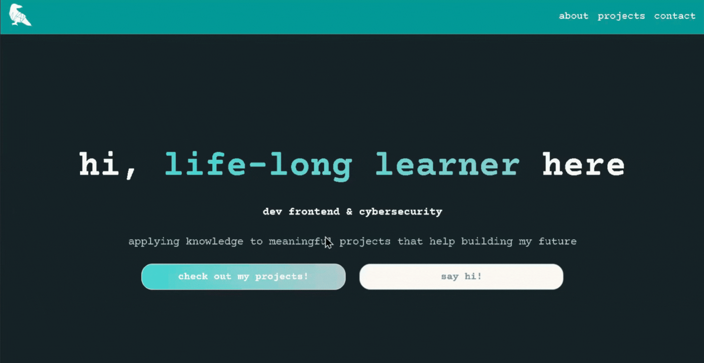
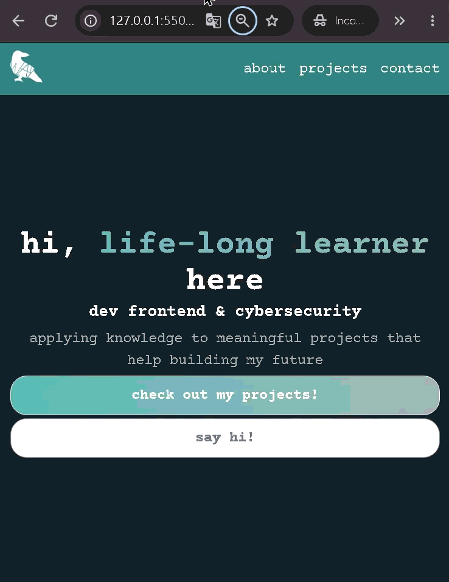

<p align="center">
  <a href="https://www.figma.com/design/cKmA01QadQI2HPQhdcaH5H/portifolio23?node-id=0-1&p=f&t=pVNOAur8NRrnLEsz-0">
    
  </a>
  <a href="https://dev-corvus.github.io/portfolio">
    
  </a>
</p>

<p align="center">
  <a href="#">
    
  </a>
  <a href="#">
    
  </a>
</p>

#  Portfolio
A responsive portfolio to showcase my skills and projects, developed as part of [Transforme-se](https://www.serasaexperian.com.br/transforme-se/).

---

## <span style="display: flex; gap: 8px;"> Visual Preview



<p align="center">
  <em>Figure 1: Full desktop layout of landing page.</em>
</p>

<p align="center">
   
</p>

<p align="center">
  <em>Figure 2: mobile responsive showing focus states.</em>
</p>

---

## <span style="display: flex; gap: 8px;"> Features

* **Semantic Web Structure:** Built entirely with native HTML5 semantic tags (`header`, `nav`, `main`, `section`, `article`, `footer`), as well as aria-label to ensure accessibility and clear document hierarchy
* **Responsive Layout:** Fluid layouts implemented using CSS Flexbox and media queries to adapt cleanly between mobile devices, tablets, and desktop displays
* **Styling & Visual Identity:** Cohesive color palette and typography centered around personal design choices, utilizing CSS custom properties (variables) for consistent maintenance
* **Extra:** Focus States in orange
---

## <span style="display: flex; gap: 8px;"> 5. Tools & Technologies

| Category | Tools / Frameworks |
| :--- | :--- |
| **Markup & Semantics** | HTML5 (Semantic Elements, ARIA Attributes) |
| **Styling & Layout** | CSS3 (Flexbox, CSS Variables, Media Queries, Focus States) |
| **Design & Assets** | [Figma](https://www.figma.com/design/cKmA01QadQI2HPQhdcaH5H/portifolio23?node-id=0-1&p=f&t=pVNOAur8NRrnLEsz-0), [Google Fonts](https://fonts.google.com/specimen/Courier+Prime) |
| **Version Control & Collaboration** | [Git, GitHub](https://github.com/dev-corvus)|
| **Code Editor** | Visual Studio Code |
|  **Deployment & Build Tools:** | [GitHub Pages](https://dev-corvus.github.io/portfolio) |

---

## <span style="display: flex; gap: 8px;"> 6. Project Structure

```text
├── assets/
│   ├── images
|   |      └── icons
├── index.html
├── style.css
└── README.md
```

---

## <span style="display: flex; gap: 8px;"> 7. Reflection & Retrospective

This section turns a generic project into a compelling case study.

### What I Learnt
* **Technical / Domain Knowledge:**
  * Did you learn a new library, algorithm, statistical method, or design technique?
  * *nth-child* - 
  * *object-fit: cover* - 
  * *clamp* - 
  * *CSS Animation:* @keyframes & [animate.css](https://animate.style/)
  * *Focus States* - focus-visible, focus-within
  * *Block* - 
  * *Position* - relative, absolute
  * *scroll-behavior: smooth !important* - 
* **Process & Workflow:**
  * improved commits: smaller features, better naming and targeting individual files when commiting

### What I Would Have Done Differently
* **Architecture & Scoping:**
  * responsive design: review clamp and character limit for responsiveness, and use cases
  * groupped classes: instead of groupping them at the end, could've thought about implementing it earlier 
* **Alternative Approaches:**
  * should've added nth-child for even numbers to change the background colour of each section
  * refine figma then start coding 
  * define css variables beforehand 
* **Future Iterations:**
  * model cards for projects descriptions
  * button to toggle english/spanish & german translations
  * hamburger menu for mobile

---

## <span style="display: flex; gap: 8px;"> 9. Acknowledgements
* Serasa Experian + Instituto PROA: For creating and supporting the educational program. Hats off to Mago da Silva.

---

## <span style="display: flex; gap: 8px;"> Author
[](linkedin.com/in/lexkawa/)

[](https://github.com/dev-corvus/)